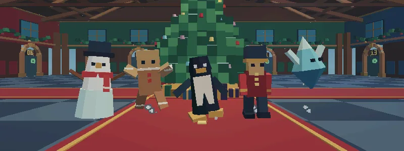

# Kalender 2026 · The Lantern Hall

**[Play The Lantern Hall on GitHub Pages](https://stbange.github.io/kalender2026/)**

A first-person Christmas hall for up to eight friends. Walk around the tree to find 24 numbered doors, try five snowcasters at the brass-bell range, or chase down the five visitors wandering the galleries. Cold contact slows your walk briefly. Clearing the hall lets you ring the practice bell for another wave.

[Download the Windows, Linux and Web builds](https://github.com/stbange/kalender2026/releases) · [GitHub Pages deployment](https://github.com/stbange/kalender2026/actions/workflows/hall.yml) · [Art credits](CREDITS.md)


Candle chandeliers and strings of colored bulbs light the aisles. The log fire and entrance chandelier cast shadows across the rugs and flagstones. Look through the low corner windows for snow-covered ridges, firs and a starry sky. [Christmas hearth](docs/hearth.png) · [Winter window](docs/winter-window.png)

## Play

Unpack the whole native archive and run `lantern.exe` or `./lantern`. The Web edition runs in a WebGL2 browser. To play the Web archive locally, extract it, run `python3 -m http.server 8000` in its folder and open `http://localhost:8000/`. Solo practice starts immediately. To meet friends, open **Join friends** in the Web menu or press **F2** in the native game, enter the same WebSocket service and room code, and connect. The Web form can copy a shareable invitation. Addresses and room codes are remembered on each device. A full room accepts a new player when someone leaves.

| Action | Desktop | Touch | Quest 3 |
| --- | --- | --- | --- |
| Walk and look | WASD / arrows and mouse | Left stick to move, drag the open screen to aim | Left stick and head tracking, right stick to snap-turn |
| Throw | Left mouse button | Tap Fire or double-tap the look area. Hold the second tap to keep firing while aiming. | Right trigger |
| Select a snowcaster | 1–5 or Q | Tap a tool | Right grip |
| Use objective | E | Use | A |
| Ring the practice bell | R | Ring bell, or Use at the range | B |
| Enter a ready door | Walk into the arch | Walk into the arch | Walk into the arch |

The pistol fires one quick snowball. The Flurry Fan throws three in a fan. Hold the Snow Spinner for rapid fire. The Bankshot bounces around corners. The Snow Rocket bursts into a cloud that can hit nearby targets. Each arrival wave includes a scarf snowman, gingerbread skipper, penguin skater, clockwork guard and frost wisp. They appear a few seconds apart. The first friend to return from a mission starts one shared return wave. Other returning friends and late arrivals join the same wave.

During playtesting, every installed mission opens as soon as its pack is available. Walk into Door 1 today in solo or a live room. The other doors follow the Warsaw calendar and show **Mission in preparation** once their date arrives. Installed missions support independent entry, shared objectives and walking back to the hall. Personal ornaments are saved on the device. Door 1 includes **Last Launch from Tinseltown**. Follow the stolen brass rocket from the Midnight Cinema to the Moon Bowl. Floor arrows and named exits lead through the diner, launch pad and lunar base. The mission unlocks five weapons with their own models, moving parts, shot effects and sounds. Hold Fire for direct shots. Aiming at a red FIZZ can clears a nearby crowd. Freeze the diner skater and tap Use to send it into the till. At the stadium, clear the hatchlings and shoot the Queen, then hit the sideline target to collect the ornament. Friends share the fights and checkpoints. [See the five weapons in-game](docs/day-one-armory.webp) · [Meet the seven enemies](docs/day-one-enemies.webp).

For local Web play, serve the extracted build with `python3 -m http.server 8000 --bind 127.0.0.1` and open `http://127.0.0.1:8000/`. Native clients can launch the executable directly.

## Snowplay feedback

The pistol snaps, the Fan scatters powder along its spread, the Spinner ratchets, the Bankshot clicks at each bounce, and the Snow Rocket leaves a trail and a ring at the burst. A short crosshair mark confirms your own hit. A diamond confirms a clear. Bells swing and ring at five pitches, and a boot icon shows when a visitor has slowed you down.

Open **Feedback** in the Web menu or press **F3** in the native game to change motion, snow detail, sound, controller vibration, hit marks, captions or high-contrast outlines. On desktop, use the arrow keys in the native panel and Escape to return. Preferences are saved on each device. The Web game uses the system’s reduced-motion preference on first launch. Optional vibration uses the firing hand in WebXR.



## Host a room on Linux

The **0.6.1** client and the **0.6.0 or 0.6.1** room service use the **tinseltown-arcade-1** mission catalog revision. The game uses the engine’s binary WebSocket format. Install the contents of the dedicated Linux room archive in `/opt/lantern`. The full Linux client archive can also host a room. From any directory, run `/opt/lantern/lantern --serve --port 8787`. For local testing use `ws://127.0.0.1:8787`. Friends on the HTTPS Pages site need a public `wss://` address.

1. Point a domain at the host. Allow inbound TCP on ports 80 and 443 for Caddy's HTTPS certificate and WebSocket traffic. Keep port 8787 private.
2. Install [Caddy](https://caddyserver.com/docs/install), replace the example domain in [hosting/Caddyfile](hosting/Caddyfile) and use it as the Caddy configuration. Caddy terminates TLS and proxies WebSocket upgrades.
3. Install [hosting/lantern-room.service](hosting/lantern-room.service) under `/etc/systemd/system/`. Run `sudo systemctl daemon-reload`, then `sudo systemctl enable --now lantern-room` and reload Caddy.
4. In **Join friends** enter `wss://your-domain` and a room code. For native command-line launch use `./lantern --connect wss://your-domain --room friends`. The existing `--serve` and `--endpoint` flags also work alongside `--server` and `--connect`. The loose `server.json` sets optional distribution defaults. Use `--ca /path/to/ca.pem` with a private CA.

The service supports 48 simultaneous connections and eight players per room. Rooms are identified by their codes and reset when everyone leaves. Native and Web clients and the service must use the same catalog revision. To roll back, deploy the previous main revision's Web archive and restart the service with its matching Linux archive.

## Build

Clone with submodules on main. The engine pin is `b0c1f7e0e22a1ee7d95f33ead218507e9f11eb60`. Both the hall client and the dedicated service use its WebSocket peers, events and channels. The engine handles native connections with SDL3_net and BearSSL, and browser connections with Emscripten WebSockets. Secure invitations use the same URL on every platform. The repository follows [Ponytail](https://github.com/dietrichgebert/ponytail) and records its acceptance scenarios in [OpenSpec](openspec/changes/add-advent-hall/).

```sh
git clone --branch main --recurse-submodules https://github.com/stbange/kalender2026
cd kalender2026
cmake -S . -B build -G Ninja -DCMAKE_BUILD_TYPE=Release
cmake --build build
python3 tools/package.py --build build --out dist/native
dist/native/lantern
```

Use a C11 compiler, CMake 3.20+, Ninja, Git, Python 3 and SDL3 with OpenGL support. The engine fetches pinned BearSSL sources and uses an installed SDL3_net or fetches its pinned 3.2.0 release. The network tests use the OpenSSL command-line tool to create a temporary CA. On Linux use a desktop with Mesa or another working OpenGL driver. The Linux room needs no display. Windows builds use an MSYS2 UCRT64 shell with GCC, CMake, Ninja and the UCRT64 `sdl3` and `sdl3-net` packages. Secure connections use the operating system's roots by default.

With Emscripten 4.0.15 active, build and serve the Web edition locally.

```sh
emcmake cmake -S . -B build-web -G Ninja -DCMAKE_BUILD_TYPE=Release
cmake --build build-web
python3 tools/package.py --web --build build-web --out dist/web
python3 -m http.server --directory dist/web 8000
```

Open localhost port 8000. WebXR uses a secure context and the Quest Browser's **Enter VR** button. Every texture, mesh, script and sound stays outside the executable. Edit the loose files and restart, or reopen the page. Regenerate the original GLB, PNG and WAV assets with `python3 tools/make_art.py` after installing Pillow. The generator also rebuilds the two shadow masks from the fixtures' positions. The flat Web view renders within 960 × 540 pixels in landscape or 540 × 960 in portrait. The HUD uses display resolution and WebXR uses the headset's eye buffers.

## Add a future mission

Give each day its own OpenSpec change. A pack registers one `MissionPacks[day]` table in an external Lua entry script. The catalog lives at `games/kalender2026/missions/catalog.json`. Assign a new shared revision when changing pack compatibility. Each entry includes a unique integer day from 1 to 24, title, script and optional list of game-relative asset files.

```json
{"revision":"lantern-2","missions":[{"day":1,"title":"Example","script":"missions/day_01.lua","files":["missions/day_01/target.glb"]}]}
```

Use `start(run)` for the shared instance, `act(run, player)` for authoritative interactions and `build(pocket, pedestal)` to populate the client scene after assets arrive. Optional `enter(run, player)` and `exit(run, player, returned)` hooks run once for each participant's transition. Returning true from `act` grants an ornament to players present in that instance. Each scene uses a walk-back threshold for exit. The server runs the same Lua rules. Put pack-specific unit tests in `tests/unit/*.lua` and record credits for every file. The [automated fixture](tests/fixture/) demonstrates the contract. Stage it explicitly with `--fixture tests/fixture` for development. Unlisted production days remain in preparation. Web archives fetch each pack's declared assets when a friend first approaches its ready doorway.

## Verify and publish

```sh
python3 -m pip install gcovr websockets playwright pillow
python3 -m playwright install --with-deps chromium webkit
npm install -g @fission-ai/openspec
openspec validate --all --strict
cmake -S . -B build-cov -G Ninja -DHALL_COVERAGE=ON
cmake --build build-cov
ctest --test-dir build-cov -R '^hall_units$' --output-on-failure
gcovr --root . --filter 'src/' --filter 'server/' --fail-under-line 95 build-cov
python3 tests/lua_coverage.py
node --test --experimental-test-coverage --test-coverage-include=web/look-taps.js --test-coverage-lines=95 tests/look_taps.cjs
ctest --test-dir build-cov --output-on-failure
python3 tests/browser_smoke.py --site dist/web --binary build-cov/lantern
python3 tests/touch_fire.py --site dist/web
python3 tests/day_one_web.py --site dist/web
```

The C coverage command uses a fresh instrumented build. Lua coverage requires Lua 5.1 and its compiler, and inventories every first-party gameplay script. The upstream tests and their independent coverage gate run under `engine/`. Main's workflow builds the Linux, Windows and Web archives, runs the headless playthrough, creates live WebSocket rooms, and exercises desktop, touch and stereo lifecycle in the browser before Pages deployment. Set the repository's **Settings → Pages → Source** to **GitHub Actions**. The operator chooses the public multiplayer hostname in-game.
