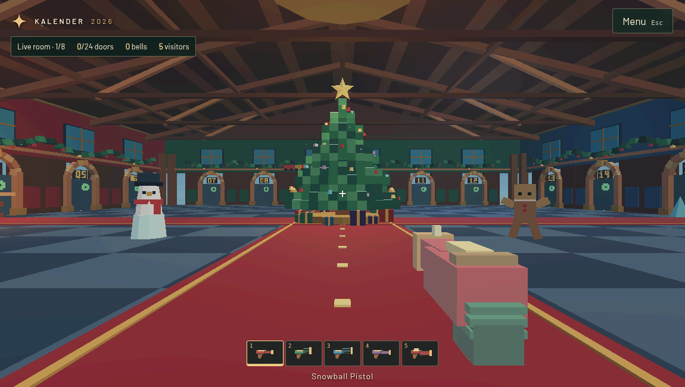

# Kalender 2026 · The Lantern Hall

A first-person Christmas hall for up to eight friends. Walk around the tree to find 24 numbered doors, try five snowcasters at the brass-bell range, or chase down the five visitors wandering the galleries. Cold contact slows your walk briefly. Clearing the hall lets you ring the practice bell for another wave.

[Play the Web edition on GitHub Pages](https://stbange.github.io/kalender2026/) · [Download a native release](https://github.com/stbange/kalender2026/releases) · [Art credits](CREDITS.md)



## Play

Unpack the whole native archive and run `lantern.exe` or `./lantern`. The Web edition runs in a WebGL2 browser. Solo practice starts immediately. To meet friends, open **Join friends** in the Web menu or press **F2** in the native game, enter the same WebSocket service and room code, and connect. The Web form can copy a shareable invitation. Addresses and room codes are remembered on each device. A full room accepts a new player when someone leaves.

| Action | Desktop | Touch | Quest 3 |
| --- | --- | --- | --- |
| Walk and look | WASD / arrows and mouse | Left stick and right-side drag | Left stick and head tracking, right stick to snap-turn |
| Throw | Left mouse button | Fire | Right trigger |
| Select a snowcaster | 1–5 or Q | Tap a tool | Right grip |
| Use objective | E | Use | A |
| Ring the practice bell | R | Ring bell, or Use at the range | B |
| Enter a ready door | Walk into the arch | Walk into the arch | Walk into the arch |

The pistol fires one quick snowball. The Flurry Fan throws three in a fan. Hold the Snow Spinner for rapid fire. The Bankshot bounces around corners. The Snow Rocket bursts into a cloud that can hit nearby targets. Each arrival wave includes a scarf snowman, gingerbread skipper, penguin skater, clockwork guard and frost wisp. They appear a few seconds apart. The first friend to return from a mission starts one shared return wave. Other returning friends and late arrivals join the same wave.

Doors become due one at a time at midnight in Europe/Warsaw, December 1–24, 2026. Solo play uses the device clock. Friends share their host's clock. A due door without a released pack says **Mission in preparation**. Installed missions support independent entry, shared objectives and walking back to the hall. Personal ornaments are saved on the device. The hall release ships with an empty mission catalog.

## Host a room on Linux

Install the contents of the dedicated Linux room archive in `/opt/lantern`. The full Linux client archive can also host a room. From any directory, run `/opt/lantern/lantern --serve --port 8787`. For local testing use `ws://127.0.0.1:8787`. Friends on the HTTPS Pages site need a public `wss://` address.

1. Point a domain at the host. Allow inbound TCP on ports 80 and 443 for Caddy's HTTPS certificate and WebSocket traffic. Keep port 8787 private.
2. Install [Caddy](https://caddyserver.com/docs/install), replace the example domain in [hosting/Caddyfile](hosting/Caddyfile) and use it as the Caddy configuration. Caddy terminates TLS and proxies WebSocket upgrades.
3. Install [hosting/lantern-room.service](hosting/lantern-room.service) under `/etc/systemd/system/`. Run `sudo systemctl daemon-reload`, then `sudo systemctl enable --now lantern-room` and reload Caddy.
4. In **Join friends** enter `wss://your-domain` and a room code. For native command-line launch use `./lantern --endpoint wss://your-domain --room friends`. The loose `server.json` sets optional distribution defaults. Use `--ca /path/to/ca.pem` with a private CA.

Each room supports eight players. Rooms are identified by their codes and reset when everyone leaves. Native and Web clients and the service must use the same catalog revision. To roll back, deploy the previous main revision's Web archive and restart the service with its matching Linux archive.

## Build

Clone with submodules on main. The engine pin is `bdf4265ebae2ca6b5f80e62d2796604ed1035847`. The transport uses bq_websocket at `6c188d3f0edca38d7a8926e0d30f4c145414ba4c` with OpenSSL and a native SNI compatibility change. The Web build uses browser WebSockets. The repository follows [Ponytail](https://github.com/dietrichgebert/ponytail) and records its acceptance scenarios in [OpenSpec](openspec/changes/add-advent-hall/).

```sh
git clone --branch main --recurse-submodules https://github.com/stbange/kalender2026
cd kalender2026
cmake -S . -B build -G Ninja -DCMAKE_BUILD_TYPE=Release
cmake --build build
python3 tools/package.py --build build --out dist/native
dist/native/lantern
```

Use a C11 compiler, CMake 3.20+, Ninja, Python 3, OpenSSL development libraries and SDL3 with OpenGL support. On Linux use a desktop with Mesa or another working OpenGL driver. The Linux room needs no display. Windows builds use an MSYS2 UCRT64 shell with GCC, CMake, Ninja, SDL3 and OpenSSL. The workflow packages the required DLLs and Mozilla CA certificates.

With Emscripten 4.0.15 active, build and serve the Web edition locally.

```sh
emcmake cmake -S . -B build-web -G Ninja -DCMAKE_BUILD_TYPE=Release
cmake --build build-web
python3 tools/package.py --web --build build-web --out dist/web
python3 -m http.server --directory dist/web 8000
```

Open localhost port 8000. WebXR uses a secure context and the Quest Browser's **Enter VR** button. Every texture, mesh, script and sound stays outside the executable. Edit the loose files and restart, or reopen the page. Regenerate the original GLB, PNG and WAV assets with `python3 tools/make_art.py` using the Python standard library.

## Add a future mission

Give each day its own OpenSpec change. A pack registers one `MissionPacks[day]` table in an external Lua entry script. The catalog lives at `games/kalender2026/missions/catalog.json`. Assign a new shared revision when changing pack compatibility. Each entry includes a unique integer day from 1 to 24, title, script and optional list of game-relative asset files.

```json
{"revision":"lantern-2","missions":[{"day":1,"title":"Example","script":"missions/day_01.lua","files":["missions/day_01/target.glb"]}]}
```

Use `start(run)` for the shared instance, `act(run, player)` for authoritative interactions and `build(pocket, pedestal)` to populate the client scene after assets arrive. Optional `enter(run, player)` and `exit(run, player, returned)` hooks run once for each participant's transition. Returning true from `act` grants an ornament to players present in that instance. Each scene uses a walk-back threshold for exit. The server runs the same Lua rules. Put pack-specific unit tests in `tests/unit/*.lua` and record credits for every file. The [automated fixture](tests/fixture/) demonstrates the contract. Stage it explicitly with `--fixture tests/fixture` for development. Unlisted production days remain in preparation. Web archives fetch each pack's declared assets when a friend first approaches its ready doorway.

## Verify and publish

```sh
python3 -m pip install gcovr websockets playwright
npm install -g @fission-ai/openspec
openspec validate --all --strict
cmake -S . -B build-cov -G Ninja -DHALL_COVERAGE=ON
cmake --build build-cov
ctest --test-dir build-cov -R '^hall_units$' --output-on-failure
gcovr --root . --filter 'src/' --filter 'server/' --fail-under-line 95 build-cov
python3 tests/lua_coverage.py
ctest --test-dir build-cov --output-on-failure
python3 tests/browser_smoke.py --site dist/web --binary build-cov/lantern
```

The C coverage command uses a fresh instrumented build. Lua coverage requires Lua 5.1 and its compiler, and inventories every first-party gameplay script. The upstream tests and their independent coverage gate run under `engine/`. Main's workflow builds the Linux, Windows and Web archives, runs the headless playthrough, creates live WebSocket rooms, and exercises desktop, touch and stereo lifecycle in the browser before Pages deployment. Set the repository's **Settings → Pages → Source** to **GitHub Actions**. The operator chooses the public multiplayer hostname in-game.
