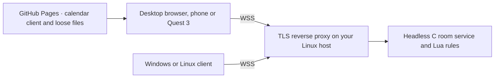

# The Lantern Hall · design and delivery

## Context

The game repository began with an MIT license. The engine revision reviewed for this proposal is `bdf4265` on `stbange/engine/main`. Its C11 library, Lua 5.1 sandbox, pocket portals, FPS controls, retro renderer, headless runner and WebXR shell cover much of the client. Its upstream CI passed at this revision. The game also needs a real eight-player transport, a civil clock and coverage of its own scripts. [Game license](https://github.com/stbange/kalender2026/blob/main/LICENSE) · [Engine revision](https://github.com/stbange/engine/tree/bdf4265ebae2ca6b5f80e62d2796604ed1035847) · [Upstream CI](https://github.com/stbange/engine/actions/runs/45493621045)

## An evening in the hall

Players arrive under the south gallery. The tree fills the first view, the hearth frames day 01 on the left, and bells from the snowball range carry across the aisle. The doors run clockwise in four banks. Each bank has an architectural landmark and silhouette as well as a color.

| Doors | Landmark | How a friend gives directions |
| --- | --- | --- |
| 01–06 | Hearth | Meet under the red stockings by the chimney. |
| 07–12 | Toy workshop | Turn at the wooden train running over the arch. |
| 13–18 | Frozen conservatory | Look for the blue windows and frost-covered ferns. |
| 19–24 | Clock gallery | Follow the ticking to the big clock above door 24. |

Timbers, stone arches and bell targets use low-poly meshes. The fir, parcels and return ornaments use voxels. Flame and snow sprites give the scene movement. Each portal has a large numeral and a physical cue. A sealed wreath marks a future door, open ribbons invite entry, a workshop placard explains pending content, and a small ornament records personal completion. Date eligibility and player avatars are shared. Each player's tree ornaments reflect their own saved collection.

The snowball range sits just off the central aisle. Friends can watch one another aim at a brass bell or a pop-up wooden bird. A hit tips the target, sounds its note and advances one shared tally. Targets reset for the next throw. The range provides the first working shooter interaction and stays available every day.

## Decisions

### Code, scripts and assets

Check out the engine under `engine/` as a submodule pinned to a tested commit from upstream `main`. Use CMake's `add_subdirectory(engine)` and link `engine::core`. The downstream C host owns platform time, transport, input adaptation, save storage and bootstrapping. Lua owns the portal table, calendar rules, target behavior and mission objectives. Share the same rule scripts with the Linux service. Keep original CC BY art in the game directory so its ownership and terms are clear alongside the engine's own notices. This applies Ponytail's reuse-first approach to the specific interfaces the engine already offers. [Engine integration](https://github.com/stbange/engine/blob/bdf4265ebae2ca6b5f80e62d2796604ed1035847/README.md) · [Ponytail guidance](https://github.com/DietrichGebert/ponytail/blob/ebd8654c2c627f721eb8f9c0d1bd4090a29f9e10/skills/ponytail/SKILL.md)

| Planned path | Responsibility |
| --- | --- |
| `engine/` | Pinned C11 engine, shared Lua runtime, shaders and upstream notices |
| `src/`, `server/` | Thin C client and headless Linux room service, shared protocol and date input |
| `games/kalender2026/game.json`, `scripts/`, `scenes/`, `assets/` | Game metadata, Lua entry point, hall geometry, art and audio under the game folder |
| `games/kalender2026/missions/catalog.json`, `missions/day_01/` | Stable day IDs, pack revisions, entry scripts, scenes, assets and credits |
| `tests/`, `games/kalender2026/tests/` | C and Lua unit tests, input-driven playtests and a co-op fixture |
| `web/`, `.github/workflows/` | Single-game Web shell, external manifest and gated Pages workflow |

The engine boots `scripts/main.lua` and its sandbox exposes a restricted set of globals. Use the existing virtual filesystem and sandbox execution API to load the catalog's named external Lua scripts. Feed the current UTC timestamp from C. This keeps file access scoped to the game and the calendar rules in testable Lua. Use the same entry points for a locally edited pack and a released pack. [Runtime boot and sandbox](https://github.com/stbange/engine/blob/bdf4265ebae2ca6b5f80e62d2796604ed1035847/src/eng_lua.c) · [Public runtime API](https://github.com/stbange/engine/blob/bdf4265ebae2ca6b5f80e62d2796604ed1035847/include/engine/eng_lua.h)

A catalog entry carries the stable day ID, title, pack revision and relative paths to the scene and Lua entry script. The pack supplies its spawn and return points, art, audio and credits. Its Lua rules initialize objective state, accept player actions and report completion. A late join receives that state from the room service. Saves use the day ID, so renaming a mission or replacing its scenery preserves the earned ornament.

### Eight friends across native, Web and VR

The inspected engine's browser WebSocket branch stores a URL. Its packet send and receive implementations cover in-process loopback and POSIX UDP. The first milestone opens a real socket from a native process and a Pages-style HTTPS browser client to a separate Linux process. Use the browser's WebSocket API through thin Emscripten glue. Use a maintained C WebSocket library such as libwebsockets for the native client and service, with TLS at the host's reverse proxy. Select and pin the library after that connection works on Linux and Windows. Include the notices for the selected components. [Engine network source](https://github.com/stbange/engine/blob/bdf4265ebae2ca6b5f80e62d2796604ed1035847/src/eng_net.c) · [libwebsockets license](https://github.com/warmcat/libwebsockets/blob/main/LICENSE)

An invitation identifies an eight-seat room. The server assigns player IDs and owns the roster, room clock, range targets and active day instances. Send small pose updates tagged with the player's space and interpolate remote avatars. Track discrete throws, target resets, completions and transitions as ordered events with IDs. A join or reconnect receives a current snapshot. Scope gameplay updates to the hall or the relevant mission. Include a protocol and content revision in the handshake so a stale client gets a clear refresh message.

Key an active mission by room and day. The first entrant starts it, later entrants receive its current objectives, and the last exit releases it. A player returning to the hall appears just outside their arch facing the tree. Use a threshold guard so one step cannot immediately send them back. All clients in a mission when its objective completes earn the day once. The service handles transient room state and each device keeps its own versioned completion record.

### The calendar and content arriving on different days

Use the trusted Linux host's ordinary UTC clock for a live room. This implements the group's trust choice and gives friends in different time zones a single calendar. Precompute the 24 Europe/Warsaw midnights as UTC instants for this specific event. An injected test clock drives the same comparison. Refresh while the game is open and send the current date state on reconnect. Published Lua and assets are inspectable in the public repository and site.

| Host time in UTC | Warsaw calendar | Due portals |
| --- | --- | ---: |
| 30 Nov 2026 at 22:59:59 | 30 Nov, just before midnight | 0 |
| 30 Nov 2026 at 23:00:00 | 1 Dec, midnight | 1 |
| 7 Dec 2026 at 23:00:00 | 8 Dec, midnight | 8 |
| 23 Dec 2026 at 23:00:00 | 24 Dec, midnight | 24 |
| 1 Jan 2027 | After the event | 24 |

Each doorway tracks its date, the availability of a compatible pack and the player's ornament. Crossing requires the date to be due and the pack to be ready. Replaying preserves the ornament. The hall milestone uses a test-only co-op room to exercise this path. In a public build, a due day awaiting content shows “Mission in preparation.” For the December release, each day's acceptance requires a distinct playable pack by its Warsaw midnight. A workshop sign counts as pending delivery.

### First-person controls and presentation

Use the engine's FPS steering, collision and doorway traversal. Desktop gets WASD and mouse look. Mobile Web automatically enables left-thumb movement, right-side drag to look and a throw button. Recover released fingers on cancel, orientation change and focus loss. On Quest 3, use the engine's stereo `first_person` rig at meter scale with controller aim, stick movement, snap turning and a level horizon. Flat Web play remains available when an immersive session ends. Use physical arch numbers and signs so both eyes can read them. [Engine game development guide](https://github.com/stbange/engine/blob/bdf4265ebae2ca6b5f80e62d2796604ed1035847/.agents/skills/engine-gamedev/SKILL.md)

Use lightweight door surfaces for distant entrances and load the destination needed for traversal. Profile a day-24 view with eight players and an active range. Initial performance targets are 60 fps on a reference desktop, 30 fps or better on representative Android Chrome and iPhone Safari devices, and a sustained 72 Hz on Quest 3. Record the devices and frame times in the release rehearsal. The phone models are still open.

### Storage and publication

Native packages resolve content relative to the executable and use a writable per-user save location. The Web shell fetches loose files relative to `/kalender2026/` and loads the hall before any mission-specific files. Mount IndexedDB at the game's actual save path, hydrate it before reading progress and flush after an award. The upstream shell mounts `/saves`, while the runtime writes `saves/` under the writable game directory. Test a full browser close and reopen using the same profile. [Web boot](https://github.com/stbange/engine/blob/bdf4265ebae2ca6b5f80e62d2796604ed1035847/web/shell_play.html) · [Save writer](https://github.com/stbange/engine/blob/bdf4265ebae2ca6b5f80e62d2796604ed1035847/src/eng_serde.c)

Use Actions on `main` to build Windows, Linux and Emscripten artifacts. Upload the tested static client with the Pages artifact workflow and point its external configuration at the operator's public WSS address. Supply the Linux service binary, game data, sample systemd unit and reverse-proxy setup. A content-only update publishes the same revision of the catalog and packs to the service and clients. Stage and verify the new revision before advertising it. Keep the previous matched artifact pair for recovery. [GitHub Pages workflows](https://docs.github.com/en/pages/getting-started-with-github-pages/using-custom-workflows-with-github-pages)

## Mission direction after the hall

Each future pack keeps the familiar first-person controls and introduces one remembered mechanic. These are candidate pitches for choosing the first mission together.

| Group memory | Original mission pitch | First co-op moment |
| --- | --- | --- |
| Duke Nukem 3D's remotely triggered pipe bombs | **Parcel Post.** Toss wind-up confetti parcels beneath frozen toy gates and pop them on cue. | A friend signals when the toy train reaches the gate. |
| Magic Carpet 2's flight and castle building | **Castle in the Clouds.** Ride woven carpets between snowy rooftops and spend collected starlight to raise a castle. | One pilot gathers starlight as another places the next tower. |
| Command & Conquer's bases, armies and huge tanks | **Tin Battalion.** Build a clockwork depot, assemble toy units and escort an oversized wind-up tank. | One friend operates the workshop while another guides the column. |
| Blood's horror atmosphere | **Midnight Matins.** Explore a candlelit crypt where a bell toll briefly reveals the safe route through the choir stalls. | One rings the bell while the other crosses the dark aisle. |
| Warcraft II's fantasy armies | **The Holly Standard.** Place banners to direct a little army of wooden knights and archers across a frozen bridge. | Friends command separate flanks that must meet at the gate. |

Create an OpenSpec change per mission. Define its day, objective, success and return behavior, late-join state, original assets and one deterministic co-op test. Register its folder in the catalog and publish it independently.

## Release sequence and risks

1. Prove native-to-browser WSS on the Linux host. A public DNS name and valid TLS certificate are operational prerequisites for connecting friends from Pages.
2. Build the walkable hall and shared range. Complete the 24-door calendar, then prove one co-op doorway while the rest of the hall keeps running.
3. Run the tests and device checks in the [implementation checklist](tasks.md). Rehearse day 01 on **30 November 2026** if the Linux endpoint and target devices are available. This is a planning target. The first real mission is a separate content deadline at **00:00 Europe/Warsaw on 1 December**.
4. Ship the matching server package and Pages client. Check the public URL and a second device joining from outside the host's network. If a release fails, redeploy the prior matching pair and preserve player saves.
